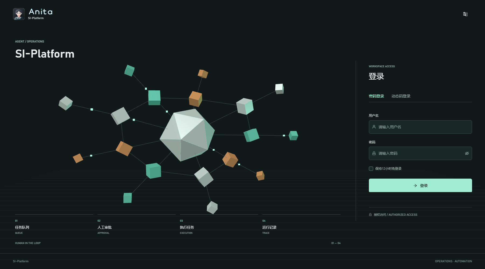
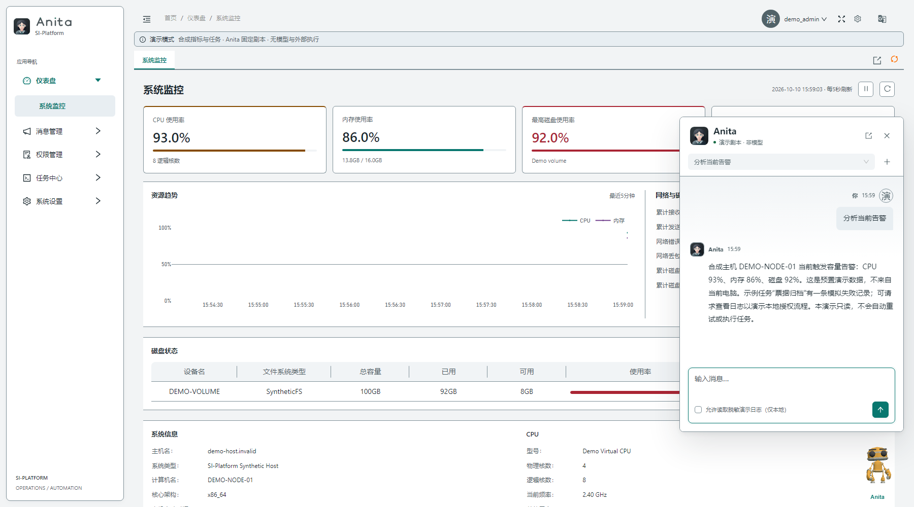
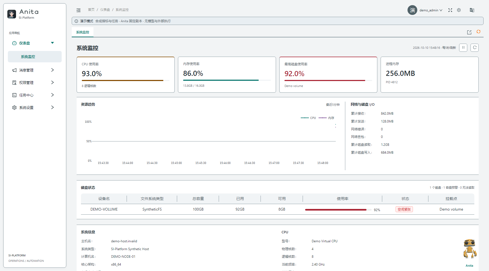
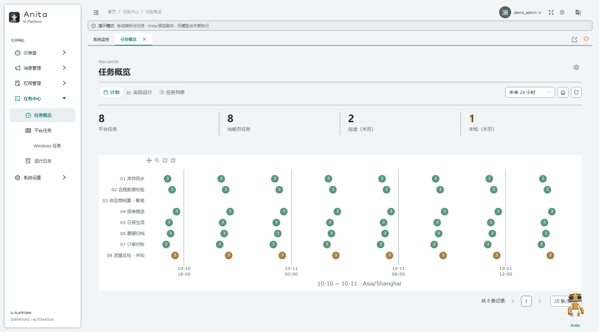
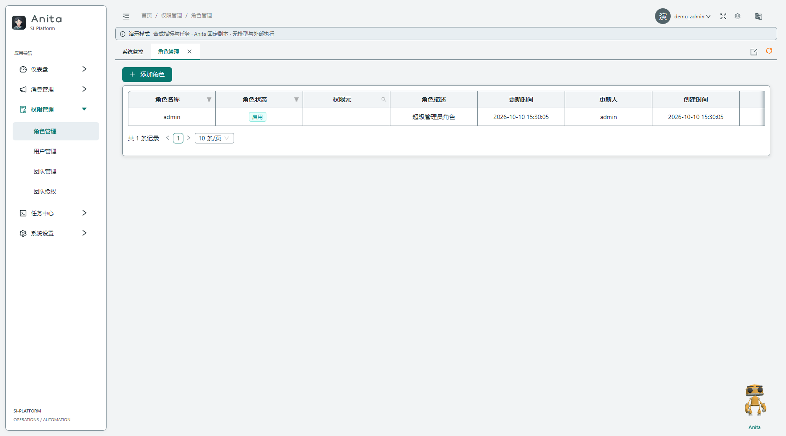

<p align="center">
  
  &nbsp;&nbsp;
  
</p>

<h1 align="center">SI-Platform</h1>

<p align="center">基于 Dash 的 Python 运维与任务自动化平台</p>

<p align="center">
  <a href="LICENSE">MIT License</a> · Windows 优先 · Python
</p>

SI-Platform 提供后台管理、权限控制、主机监控和统一任务中心。任务调度、Windows 原生计划任务和可选 AI Agent 有明确的运行边界；演示与测试使用隔离数据，不代表生产系统已完成安全或外部服务认证。

## 三分钟隔离演示

无需模型密钥或外部服务。从项目根目录运行：

```powershell
python scripts/demo_task_center.py --port 8097
```

打开 `http://127.0.0.1:8097/demo`。这是仅监听本机的临时演示服务，使用临时 SQLite；进程退出后数据清理，不启动真实 scheduler，也不读取本机系统指标。

1. 在系统监控中查看预置合成告警：CPU 93%、内存 86%、磁盘 92%。
2. 打开 Anita，询问“分析当前告警”；页面明确标注固定剧本，不是模型生成。
3. 询问“查看票据归档的最近运行日志”。首次请求会拒绝读取；勾选“允许读取脱敏演示日志（仅本地）”后重发，展示权限保护下的本地合成日志和工具记录。
4. 询问“运行任务票据归档”；演示只读分析，不生成审批或运行任务。平台任务、Windows 任务及回执全部为模拟。

[播放 MVP 演示视频（WebM，约 15 秒）](screenshots/si-platform-mvp-demo.webm)。视频由 Playwright 直接录制，展示告警分析、日志授权前后的行为和拒绝执行边界。

重新录制需安装 Playwright 和 Chromium，并先启动上面的隔离演示服务：

```powershell
$env:PLATFORM_TASK_DEMO_URL = 'http://127.0.0.1:8097'
python scripts/record_demo_video.py
```

演示入口只由该脚本注册，不可用于生产部署。它不调用外部模型、scheduler、Windows 任务、SSH 或通知服务；要展示真实集成，需另行配置和认证。

## 功能

- 登录、动态码、OAuth2 Provider，以及用户、角色、团队和页面权限管理。
- 多页面后台、中文/英文界面、个人资料、主题偏好和系统资源监控。
- 统一任务中心：任务概览、本机或 SSH 平台任务、运行日志、数据提取和通知。
- 周期、Cron、单次和邮件 POP3 监听触发；任务保存后默认暂停，需显式恢复。
- Windows 任务计划程序独立管理。不会自动导入、停用、删除或双向同步 Windows 任务。
- 可选 Agent：通过 OpenAI 兼容接口读取受权限限制的任务信息；日志外发需用户授权。已有任务执行审批默认关闭，必须显式配置白名单并由用户确认。

## Dash 页面模板

页面脚手架生成主题适配的指标、示例记录、搜索/状态筛选和表格，并在筛选回调中校验页面权限。先预览，再生成：

```powershell
python scripts/scaffold_page.py --module analytics --title 分析中心 --subpage 总览:overview:1 --dry-run
python scripts/scaffold_page.py --module analytics --title 分析中心 --subpage 总览:overview:1
```

生成的记录明确标为示例数据；业务接入时应替换 fixture 并为写操作实现独立的服务端授权。更多页面约定见[新增页面指南](docs/add_page_guide_full.md)。

## 快速启动

当前提供 Windows 依赖清单。建议使用 Python 3.11 和独立虚拟环境：

```powershell
python -m venv .venv
.\.venv\Scripts\Activate.ps1
python -m pip install -r requirements_win.txt
Copy-Item src\config\dashgo.ini.example src\config\dashgo.ini
```

首次启动前编辑 `src/config/dashgo.ini`，为 `CommonConf.ENCRYPT_KEY`、`FlaskConf.COOKIE_SESSION_SECRET_KEY` 和 `JwtConf.JWT_SECRET_KEY` 分别生成并填写独立随机值。加密密钥应为 32 个随机字节的 64 位十六进制文本；不要使用模板占位符，也不要把实际配置提交到 Git。

可在 PowerShell 中生成随机值：

```powershell
python -c "import secrets; print(secrets.token_hex(32))"
python -c "import secrets; print(secrets.token_urlsafe(48))"
```

初始化数据库后，以暂停调度模式启动 Web 和独立 scheduler：

```powershell
python scripts/start_ap.py --only-init
$env:SMART_AGENT_SCHEDULER_RPC_SECRET = python -c "import secrets; print(secrets.token_urlsafe(48))"
python scripts/start_ap.py --scheduler-mode paired_paused
```

Web 默认访问地址为 `http://127.0.0.1:8090`。首次初始化会创建 `admin` 账号，初始密码为 `admin123`；首次登录后必须立即修改。`paired_paused` 不恢复已有调度任务。确认目标数据库中的任务、脚本和外部影响后，再按[任务中心指南](docs/task_center.md)决定是否恢复。

只运行 Web、不启动 scheduler：

```powershell
python scripts/start_ap.py --scheduler-mode web_only
```

如果 Web 要连接另一个 scheduler，Web 与 scheduler 必须配置相同的 `SMART_AGENT_SCHEDULER_RPC_SECRET`（至少 32 个 UTF-8 字节）。不要将 RPC 暴露到公网。启动策略、维护迁移和停止行为见[任务中心指南](docs/task_center.md)。

`src/config/dashgo.ini.example` 是配置模板；实际配置文件已被 Git 忽略。`.env.example` 只列出可选环境变量，程序不会自动加载 dotenv 文件。Agent 配置示例和审批限制见下文及[安全说明](docs/security_audit.md)。

## Agent 配置

Agent 默认不可用，未配置模型时不会生成模拟回答。按需在启动 Web 的 PowerShell 中设置兼容服务信息并重启：

```powershell
$env:SMART_AGENT_BASE_URL = 'https://api.openai.com/v1'
$env:SMART_AGENT_MODEL = '服务商提供的模型名'
$env:SMART_AGENT_API_KEY = '本机环境中的真实密钥'
```

真实密钥不要写入仓库、配置模板或提交记录。Agent 运行已有任务的功能默认关闭；启用需要审查环境内的任务后，通过服务端 `SMART_AGENT_RUN_ALLOWLIST` 配置明确的任务 ID 列表，并在界面逐次审批。提交结果未知时系统不会自动重试。详见[任务中心指南](docs/task_center.md#agent-审批边界)与[安全说明](docs/security_audit.md)。

## 测试

```powershell
python -m pytest tests -q
```

浏览器验收为显式 opt-in，需要 Playwright 和 Chromium；具体环境变量和测试范围见[任务中心指南](docs/task_center.md#隔离演示与浏览器验收)。测试结果不代表真实 SSH、通知供应商、第三方 OAuth2、MySQL 生产迁移或 Windows 任务生命周期已联调。

## 文档

- [任务中心：页面、权限、启动策略、运行状态、隔离演示与维护迁移](docs/task_center.md)
- [任务配置：周期、Cron、监听、脚本、SSH、通知和日志](docs/task.md)
- [Windows 原生任务行为与安全边界](docs/windows_scheduler.md)
- [新增应用与页面脚手架](docs/add_page_guide_full.md)
- [安全说明与审计状态](docs/security_audit.md)
- [项目结构与开发入口](docs/project_inventory.md)
- [旧 RPA 文档索引](docs/rpa_scheduler_usage.md)

## 界面截图

| 登录 | Agent 浮窗 |
| --- | --- |
|  |  |

| 系统监控 | 任务中心 |
| --- | --- |
|  |  |

| 任务日志 | 角色管理 |
| --- | --- |
|  |  |

仓库截图仅为界面样例，不代表实时状态。隔离演示中的监控指标、任务和回执均为合成数据；截图和演示都不构成真实模型、SSH、通知或 Windows 生命周期认证。

## 项目结构

```text
scripts/                 启动、页面脚手架、迁移和隔离演示工具
src/
  app.py                 Web 入口
  app_apscheduler.py     独立 scheduler 服务
  common/                Agent、任务中心及通用服务
  config/                页面注册和本地配置模板
  dash_callback/         Dash 回调
  dash_view/             页面视图
  database/              Peewee 实体与 DAO
  assets/                CSS、JavaScript、图像和前端依赖
  translations/          国际化词条
tests/                   单元、集成和 opt-in 浏览器测试
docs/                    操作、安全和开发文档
screenshots/             隔离演示界面截图
```

## 安全与部署提示

本项目可执行本机或 SSH 脚本，应仅在受控网络和最小权限服务账户下运行。HMAC 调度 RPC 提供认证但不加密传输；需要通过可信网络隔离，不能直接公开端口。默认管理员密码、旧 SHA-256 密码散列及密钥轮换策略都需要部署方处理。当前仓库不声明通过全面安全认证；部署前请阅读[安全说明](docs/security_audit.md)，重新执行依赖与代码扫描并完成环境专项评估。

## 许可证

项目以 MIT License 发布，保留原始许可声明。Three.js 和机器人模型等第三方资源另有各自许可说明，详见 README 中的资源文件及其随附许可证。
