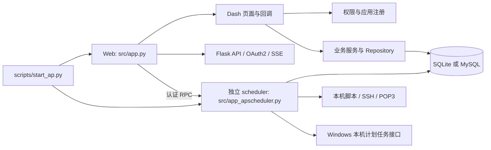

# 项目结构与运行边界

SI-Platform 是基于 Dash、Flask、Feffery 组件和 Peewee 的后台管理与任务自动化应用。本文记录当前代码入口、模块归属和本地数据位置，不是迁移操作手册；任务运行和维护规则见[任务中心指南](task_center.md)。

## 运行结构



Web 与 scheduler 分开运行；Web 只有在配置相同的 RPC 共享密钥时，才能连接独立 scheduler。Windows 原生任务与 APScheduler 是两套独立执行系统。

## 主要目录

| 路径 | 职责 |
| --- | --- |
| `scripts/start_ap.py` | Web/scheduler 统一启动、暂停策略、显式数据库初始化 |
| `scripts/demo_task_center.py` | 临时 SQLite 和模拟执行的任务中心演示服务 |
| `scripts/migrate_task_center.py` | 任务中心只读盘点及显式维护迁移 |
| `scripts/scaffold_page.py` | 生成并注册自定义应用页面 |
| `src/app.py`、`src/server.py` | Dash 根应用、Flask 服务与请求处理 |
| `src/app_apscheduler.py` | 独立 APScheduler 服务和受控执行入口 |
| `src/config/applications.json` | 自定义应用模块注册清单 |
| `src/config/access_factory.py` | 内置页面加载、菜单与权限元数据 |
| `src/config/anita_go.ini.example` | 本地运行配置模板；实际 `anita_go.ini` 不应提交；旧 `dashgo.ini` 可兼容读取 |
| `src/dash_view/` | 登录页、主框架和各应用页面布局 |
| `src/dash_callback/` | Dash 交互回调；敏感动作必须服务端复核权限 |
| `src/common/task_center.py` | 统一任务权限、生命周期、运行护栏与日志服务 |
| `src/common/agent.py`、`agent_actions.py` | 可选 OpenAI 兼容 Agent 与已有任务审批边界 |
| `src/database/sql_db/` | Peewee 数据库连接、实体和 Repository (`repositories/`) |
| `src/assets/` | CSS、JavaScript、图片及带许可证的前端资源 |
| `tests/` | 单元、集成以及显式启用的浏览器/系统探测 |
| `docs/`、`screenshots/` | 当前操作指南和隔离演示页面截图 |

## 应用注册与权限

内置应用由 `src/config/access_factory.py` 导入；自定义应用通过 `src/config/applications.json` 注册，并由 `scripts/scaffold_page.py` 生成初始视图与回调。页面元信息中的 `title`、`icon`、`order` 和 `access_metas` 用于导航和权限映射。

页面入口的权限检查不能替代回调端授权。读取敏感数据、下载、配置变更、任务执行和团队授权等操作都必须在服务端重新检查当前账号、对象归属和具体动作。删除或改名页面后，代码中的权限清单与数据库中的既有授权需谨慎核对；平台不会自动删除历史角色数据。

新增页面步骤见[页面开发指南](add_page_guide_full.md)。

## 数据与本地状态

- 默认 SQLite 文件按 `src/config/anita_go.ini`（或兼容读取的 `src/config/dashgo.ini`）中的相对路径解析；示例指向项目根目录的 `app.db`。MySQL 参数也在本地 INI 中，MySQL 部署和任务中心迁移需要单独验证。
- 用户头像运行时写入 `user_data/avatars/`；备份、会话数据和本地缓存不应公开提交。
- `cache/` 用于扫描报告、浏览器截图、临时工具和其他生成物；不是应用源代码。
- APScheduler 持久 Job Store 与任务中心映射共同影响执行状态。备份和恢复必须同时考虑数据库、Job Store、本地配置和凭据。
- 应用配置可能包含密钥和数据库密码。仓库仅保留 `.example` 模板；真实 INI、环境变量文件和数据库均由部署环境管理。

## 开发与验证

Windows 环境按根目录 README 安装 `requirements_win.txt`、准备本地 INI，再使用统一启动器。安全的首次检查模式为 `paired_paused`；运行已有任务前必须确认目标数据库和任务定义。

基础回归：

```powershell
python -m pytest tests -q
```

此命令可能执行隔离目录中的本地脚本测试。修改 Windows 原生任务的探测测试需要显式环境变量授权；不要对生产主机运行。Chromium 测试和隔离演示入口见[任务中心指南](task_center.md#隔离演示与浏览器验收)。

本项目未声明已完成真实 SSH、第三方通知、外部 OAuth2 客户端、MySQL 生产迁移或公网安全认证。部署评估见[安全说明](security_audit.md)。
