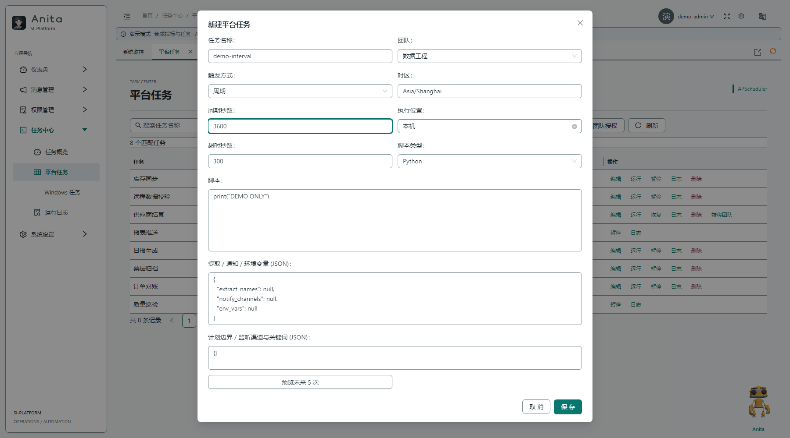
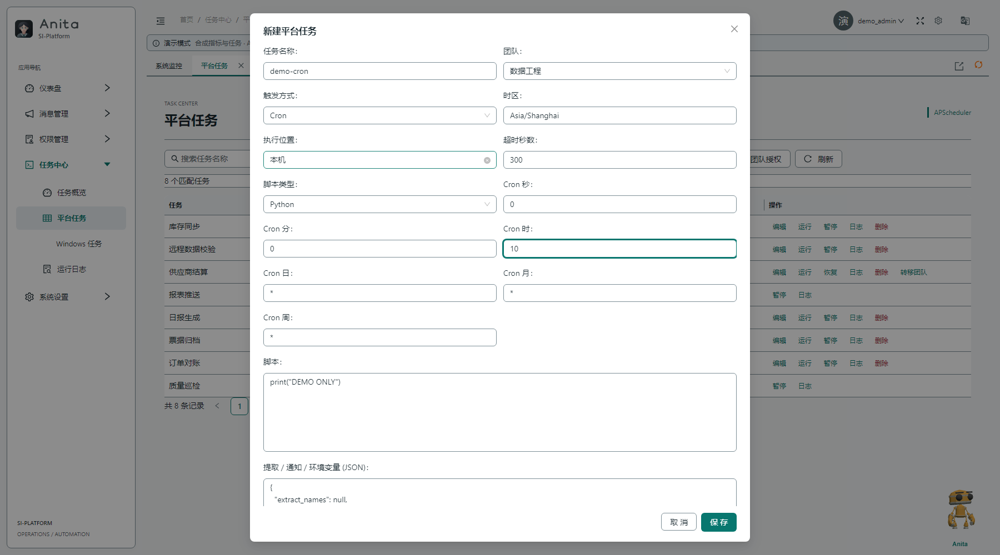
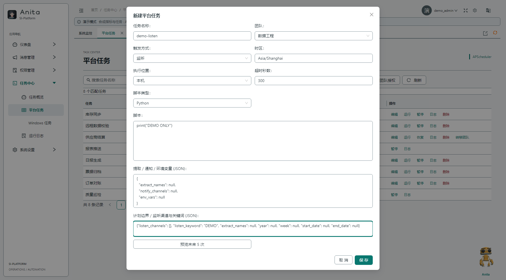
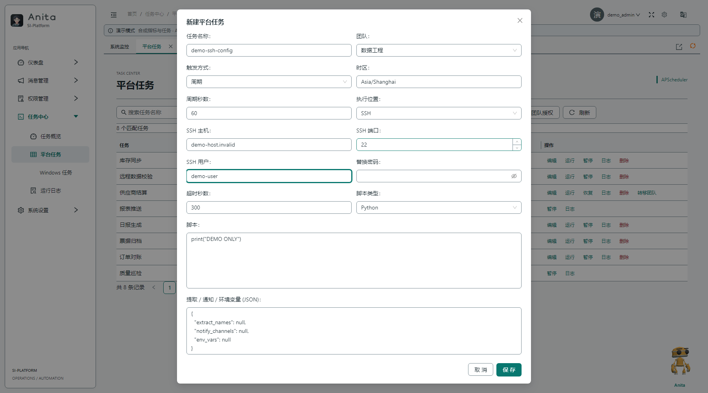
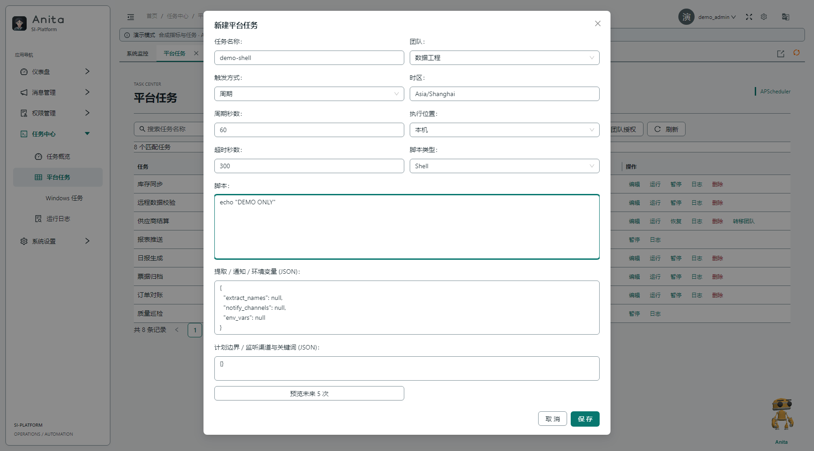
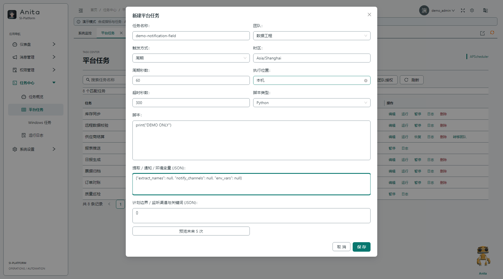
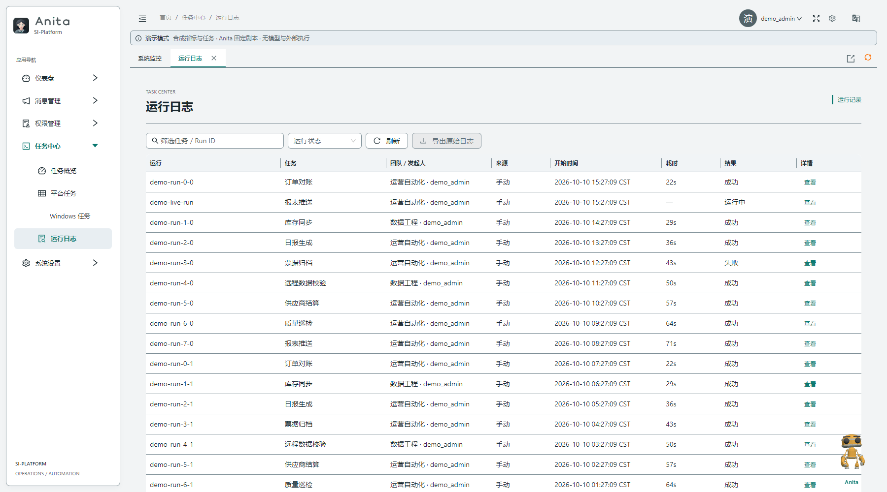
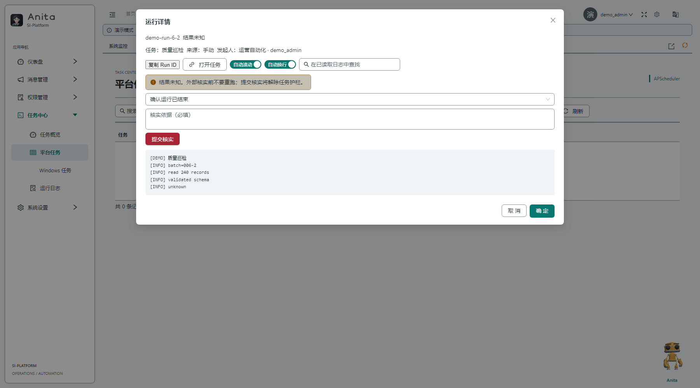

# 任务配置与通知

本文说明统一任务中心中任务的配置字段。服务启动、团队权限、运行状态、人工核实和维护迁移见[任务中心指南](task_center.md)。

## 页面入口

- 任务概览：`/task_/overview`
- 平台任务：`/task_/task_mgmt`
- Windows 原生任务：`/task_/windows_scheduler`
- 运行日志：`/task_/task_log`

页面是否可见不代表对每条任务都有操作权。服务端会按账号、团队成员关系和已授予操作再次校验权限。

## 创建平台任务

在“平台任务”页选择“新建任务”，填写名称、团队、触发方式、时区、执行位置、超时、脚本类型和脚本。支持的触发方式：

- **周期**：按秒设置 Interval。
- **Cron**：按秒、分、时、日、月、周和可选计划边界设置 Cron，并指定时区。
- **单次**：指定一次运行时间。
- **监听**：选择已配置的 POP3 邮箱监听通道，并匹配邮件标题关键词。

执行位置为本机或 SSH。SSH 需要目标主机、端口和用户名；密码不会在编辑界面回显。编辑 SSH 任务时，密码字段留空表示保留原凭据。

脚本类型为 Python、Bat 或 Shell。超时范围为 1 至 86400 秒。创建或编辑保存后任务保持暂停；核对脚本、时区和下一次触发时间后，再执行显式恢复。预览时间由 APScheduler 触发器计算，不代表脚本运行时长。

| 配置项 | 示例 |
| --- | --- |
| 触发方式 | 周期 60 秒，或 Cron `0 0 * * * *` 对应界面字段 |
| 脚本 | `print('job finished')` |
| 数据提取 | 在输出中写入 `<SOPS_VAR>cpu_load:99.1</SOPS_VAR>`，并配置要提取的变量 |
| 通知 | 选择已配置的渠道名称；通知正文由对应的 `<SOPS_VAR>名称:内容</SOPS_VAR>` 输出提供 |

提取与通知字段使用任务编辑表单中的 JSON 配置。结构示意：

```json
{
  "extract_names": null,
  "notify_channels": ["运维通知"],
  "env_vars": null
}
```

`notify_channels` 填写系统设置中已有的通道名称。可用渠道包括 Server 酱、企业微信群机器人、SMTP 邮件和 Gewechat，具体取决于已安装和配置的接口。不要把真实密码、SMTP 凭据或机器人密钥写入脚本或文档。

## 邮件监听任务

先在“系统设置 → 监听接口”配置 POP3 邮箱通道并激活，再创建“监听”触发任务。邮件标题包含所配关键词时，任务收到以下环境变量：

| 环境变量 | 内容 |
| --- | --- |
| `__title__` | 邮件标题 |
| `__from__` | 发件人 |
| `__desp__` | 邮件正文 |
| `__datetime__` | 接收时间 |

监听任务的 `env_vars` 由收到的邮件事件生成，不能用静态环境变量替代。POP3 轮询间隔由系统配置控制。邮件正文可能含敏感信息，脚本输出和日志应避免不必要地回显。

## 通知通道

在“系统设置 → 通知接口”新增并配置通道，完成连通性核对后再激活。任务通过 `notify_channels` 绑定一个或多个已命名通道。配置通知只表示允许该任务使用通道，不保证第三方服务已收到消息；实际发送结果需查看运行日志与供应商侧记录。

## 运行与排查

运行日志按任务和 Run ID 查询。状态“已提交”表示调度器已受理，不等于脚本成功；Windows 的“原生命令已受理”也不代表完成。`unknown` 表示当前无法可靠判定结果，不会自动重试或释放串行护栏。先到目标执行端核对副作用，再由有权限的人员提交人工核实依据。完整状态语义见[任务中心指南](task_center.md#运行状态与未知结果)。

任务截图使用隔离演示数据：

| 配置与运行界面 | 截图 |
| --- | --- |
| 周期任务 |  |
| Cron 任务 |  |
| 邮件监听 |  |
| SSH 执行 |  |
| Shell 脚本 |  |
| 通知配置字段 |  |
| 运行记录 |  |
| 运行详情 |  |

Windows 任务是服务器本机的原生计划任务，不通过上述平台脚本配置创建。平台不会自动把它们导入 APScheduler，也不会替管理员停用原生任务；详见[Windows 任务说明](windows_scheduler.md)。
