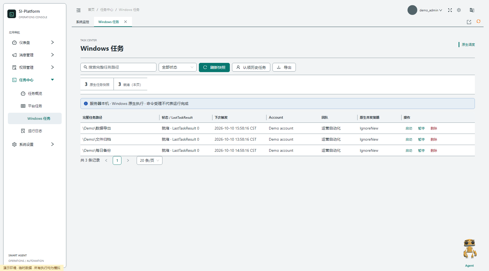

# Windows 原生任务计划程序

本文说明 Windows Task Scheduler 与 SI-Platform 的关系。平台页面只管理当前 Web 主机、当前服务账号可见的原生任务；不是跨主机任务代理，也不是 APScheduler 的导入/同步界面。完整运行和团队权限规则见[任务中心指南](task_center.md)。

## 数据与操作边界

- Windows Task Scheduler 是原生任务定义和触发器的事实来源。平台读取快照，不复制或改写 Principal、触发器、执行条件或 `MultipleInstancesPolicy`。
- 平台不会自动导入原生任务至 APScheduler，不会双向同步，也不会因为认领任务而自动停用原生任务。
- “刷新快照”重新读取服务账号能够枚举的任务；看不到任务不代表任务不存在，可能是权限或服务身份范围不同。
- 平台的启动、暂停、恢复和删除操作会影响真实原生任务。操作前核对完整任务路径、运行身份、动作和影响范围；请勿在生产系统用演示数据验证。

## Windows Task Scheduler 常见字段

### General（常规）

查看任务名称和文件夹路径、创建者、运行账号、仅在登录时运行/无论用户是否登录时运行、最高权限选项及目标 Windows 版本。服务账号应采用满足任务需求的最低权限。改变运行身份或选择“最高权限”会改变真实安全边界。

### Triggers（触发器）

触发器定义何时运行，例如按计划、登录、启动、空闲或事件触发。计划触发器还可配置每日/每周/每月规则、开始/结束时间、延迟、重复间隔和有效期。多触发器、重复规则、时区和事件条件不会被平台改写；如需调整，请在 Windows 原生界面维护并确认原生历史记录。

### Actions（操作）

核对可执行文件、参数和“起始于”目录。相对路径依赖任务的工作目录与服务身份；交互式登录用户和后台服务账户看到的映射盘、配置文件、证书、网络权限可能不同。

### Conditions（条件）与 Settings（设置）

检查空闲、电源、网络和唤醒条件，以及错过计划后的处理、运行超时、失败重启和多实例策略。原生任务的重试或排队规则仍由 Windows 执行；平台串行护栏不会阻止 Windows 自行触发，也不替代原生并发设置。

## 平台状态与运行结果

列表展示完整任务路径、原生状态、下次触发、运行账号、团队映射、并发策略和 `LastTaskResult`。返回码应与任务历史、Action 输出及 Windows 事件记录一起判断，不应仅凭单个代码推断业务成功。

通过平台启动任务后，`accepted` 仅表示 Windows 已受理命令，不代表动作成功或运行完成。平台不会为原生任务伪造 stdout。若提交状态不确定，运行记录可能成为 `unknown`；先在原生计划程序和实际目标系统核实，不要重复启动。

删除平台映射不会作为导入流程自动删除原生任务。删除原生任务是实际破坏性操作；确认备份、路径及运行状态后再由有权限人员执行。对 unknown 任务，先核实原生定义是否禁用或已不存在，再在平台提交核实理由。

截图使用隔离模拟任务，截图中的操作按钮不会改变你的 Windows 任务：

## 迁移注意事项

切换 Windows 与 APScheduler 执行权属于人工维护，不是自动迁移：

1. 导出或备份原生任务定义，逐项核对触发器、账号、动作、参数、起始目录、条件和并发策略。
2. 明确目标执行器、团队归属、权限和重复触发风险。
3. 在维护窗口人工暂停原生任务或平台任务中的一方，并确认另一方不会提前运行。
4. 对照目标系统和运行日志核验首轮结果，再逐项恢复。

不要同时启用语义相同的原生任务和平台任务。平台迁移脚本不是自动切换工具；旧 RPA 导入说明已归档，见[历史入口索引](rpa_scheduler_usage.md)。
